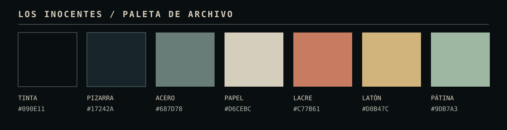

# Paleta — tinta, papel y metal

[Abrir y ajustar la paleta en Coolors](https://coolors.co/090e11-17242a-687d78-d6cebc-c77b61-d0b47c-9db7a3).

La referencia visual sugiere un archivo físico visto a través de una terminal. La base es azul casi negra; el texto tiene el calor de papel envejecido. El lacre aparece solo en acciones, navegación activa y sellos. Las puntuaciones usan latón; los estados, una pátina gris verdosa. Así evitamos que todos los elementos compitan con el mismo rojo, verde y amarillo luminosos.

| Papel en la interfaz | Color | Uso |
| --- | --- | --- |
| Tinta | `#090e11` | Fondo de página y controles profundos |
| Pizarra | `#17242a` | Paneles y tarjetas |
| Acero | `#687d78` | Bordes visibles y separadores principales |
| Papel | `#d6cebc` | Texto principal |
| Lacre | `#c77b61` | Acciones, navegación activa y marcas puntuales |
| Latón | `#d0b47c` | Puntuaciones y cifras destacadas |
| Pátina | `#9db7a3` | Estados y registros secundarios |

Variantes funcionales: `#adb8aa` para texto secundario, `#f4e8d4` para texto sobre el botón de lacre, `#8f3f34` para su fondo y `#354a4c` para separadores discretos. Estas variantes no añaden colores protagonistas.

## Combinaciones comprobadas

| Texto / fondo | Contraste calculado |
| --- | ---: |
| Papel / tinta | 12,39:1 |
| Papel / pizarra | 10,15:1 |
| Texto secundario / pizarra | 7,72:1 |
| Acento claro / pizarra | 7,27:1 |
| Texto claro / botón de lacre | 5,92:1 |
| Latón / pizarra | 7,94:1 |

El fondo usa un degradado oscuro sin cuadrícula. Dos capas fijas, con líneas de barrido, un matiz RGB muy tenue y viñeta, crean el filtro CRT sobre toda la web sin interceptar clics. La textura es decorativa y no transmite estados; el modo de contraste aumentado la elimina. No hay parpadeo ni movimiento. Las imágenes promocionales conservan sus colores originales, y las imágenes de archivo no se presentan como fotos de una sala concreta.
